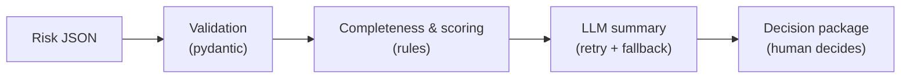

# Risk Review Helper

[](https://github.com/arturan2101/risk-review-helper/actions/workflows/ci.yml)

A small Python CLI that takes a risk description (JSON) and prepares a **decision package** for a
human expert: a completeness check, a risk score, and an LLM-drafted summary and recommendation.
The final decision always stays with a human.

## Why

Risk reviews often stall on the same things: missing information, scattered expert opinions, and
no shared starting point for discussion. This tool is inspired by AI-assisted risk alignment: the
AI **prepares** the case (what's missing, how severe it is, a first draft) so the experts can spend
their time on the decision itself. It never makes the decision.

## Pipeline



1. **Validation** rejects malformed input with a clear, per-field error message.
2. **Completeness & scoring** are deterministic rules: missing fields, warnings,
   `risk_score = likelihood × impact`, risk level, expert consensus.
3. **LLM summary** asks a local model for a JSON draft. The answer is validated; on bad output
   it retries once with a stricter prompt, then falls back to a rule-based summary.
4. **Decision package** combines everything, with `requires_human_decision: true`.

## Quickstart

Requires Python 3.12+.

```bash
git clone https://github.com/arturan2101/risk-review-helper.git
cd risk-review-helper
python -m venv .venv
source .venv/bin/activate          # Windows: .venv\Scripts\activate
pip install -r requirements.txt
```

**Rules only, no model** (instant):

```bash
python -m risk_helper examples/incomplete_risk.json --no-llm
```

**With a real local model** ([Qwen2.5-0.5B-Instruct](https://huggingface.co/Qwen/Qwen2.5-0.5B-Instruct),
runs on CPU). The first run downloads about 1 GB; after that, expect roughly 20–30 s per risk on a laptop.

```bash
pip install -r requirements-llm.txt
python -m risk_helper examples/incomplete_risk.json
```

| Option | Effect |
|---|---|
| `--no-llm` | Skip the LLM step; `llm_status: "skipped"`, recommendation `undecided` |
| `--fake-llm` | Use a canned LLM answer (demos, CI) |
| `--output FILE` | Write the JSON to a file instead of stdout |

Exit code is `1` with a readable message for a missing file, invalid JSON, or invalid fields.

### Input format

| Field | Required | Values |
|---|---|---|
| `id`, `title`, `description` | yes | non-empty strings |
| `category` | no | `it`, `vendor`, `security`, `compliance`, `operational` |
| `likelihood`, `impact` | no | integers 1–5 |
| `owner`, `mitigation` | no | strings |
| `expert_opinions` | no | list of `{expert, rating: low\|medium\|high, comment}` |

See [`examples/`](examples/) for complete files. Unknown fields are rejected, so a typo like
`likelyhood` is reported instead of silently counted as missing.

## Example output

Real output for [`examples/incomplete_risk.json`](examples/incomplete_risk.json) with the
default model:

```json
{
  "risk_id": "R-002",
  "completeness": {
    "score": 0.5,
    "missing_fields": [
      "owner",
      "mitigation",
      "expert_opinions"
    ],
    "warnings": [
      "Impact is 5 but no mitigation is defined."
    ]
  },
  "risk_score": 20,
  "risk_level": "high",
  "expert_consensus": "none",
  "summary": "Outdated firmware on a remote-access VPN gateway",
  "draft_recommendation": "mitigate",
  "rationale": "The outdated firmware poses a significant security risk as it lacks critical updates, making the system vulnerable to vulnerabilities identified in the vendor's critical security advisory.",
  "llm_status": "ok",
  "requires_human_decision": true
}
```

Everything above `summary` comes from rules; `summary`, `draft_recommendation` and `rationale`
come from the model. Note the short summary. See [Limitations](#limitations).

## Design decisions

- **Completeness and scoring are rule-based.** They are deterministic, cheap and fully
  testable. An LLM adds nothing to counting missing fields or multiplying two numbers.
- **LLM output is validated, never trusted.** The parser extracts the first JSON object (models
  like to wrap it in prose or code fences), checks the keys and the recommendation value, retries
  once with a stricter prompt, and falls back to a rule-based draft instead of crashing.
- **The LLM sits behind a one-method interface** (`generate(prompt) -> str`). Tests and CI use
  `FakeLLM`, so they run in about a second, with no model download and no network access.
  `transformers` is imported lazily, so the core works without it.
- **`requires_human_decision` is always `true`**, enforced by the schema itself
  (`Literal[True]`). The tool drafts; accountability stays with people.

## Limitations

- Qwen 0.5B is small. In testing it reliably produced valid JSON and sensible recommendations,
  but its `summary` usually just restates the title, and the `rationale` can contain claims that
  aren't in the input. Several prompt variants were tried; the limit is the model size.
- Validation guarantees the **structure** of the answer, not its truth. That's exactly why the
  output is a draft for a human reviewer.

## Testing & CI

GitHub Actions runs on every push and pull request (Python 3.12):

1. `ruff check .`: lint
2. `ruff format --check .`: formatting
3. `pytest -v`: unit and CLI tests
4. `python -m risk_helper examples/complete_risk.json --fake-llm`: end-to-end smoke test

No real model is ever loaded in tests or CI. A test even blocks the `transformers` import to make
sure of that. To run the same checks locally:

```bash
pip install -r requirements-dev.txt
ruff check . && ruff format --check . && pytest
```

## Project structure

```
risk_helper/
├── models.py        # pydantic schemas (input, output)
├── completeness.py  # rule-based checks and scoring
├── llm.py           # LLM interface, FakeLLM, HuggingFaceLLM
├── summarizer.py    # prompt, JSON parsing, retry + fallback
└── cli.py           # argument parsing and wiring
tests/               # pytest suite (FakeLLM only)
examples/            # sample risk descriptions
```

## Possible next steps

- **Retrieval of similar past decisions** (e.g. FAISS over earlier decision packages), so the
  draft can say "a similar risk was mitigated like this last year".
- **A small evaluation set** of risks with expected recommendations, to compare prompts and
  models with numbers instead of by eye.
- **A `--model` option** to plug in a larger model (e.g. Qwen2.5-1.5B) when quality matters more
  than speed.
- **A REST API and a Docker image** for integration into an existing review workflow.
